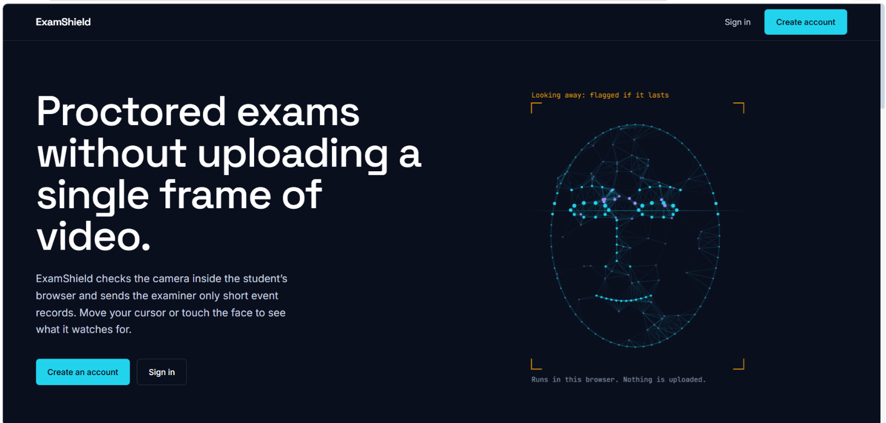
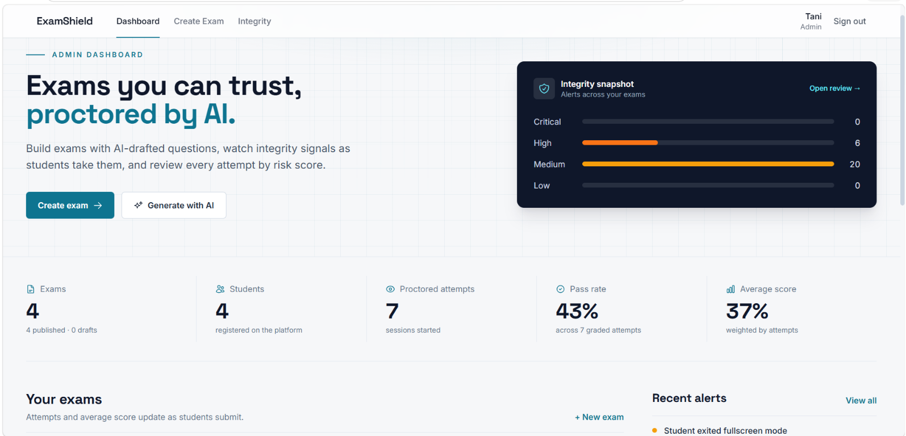
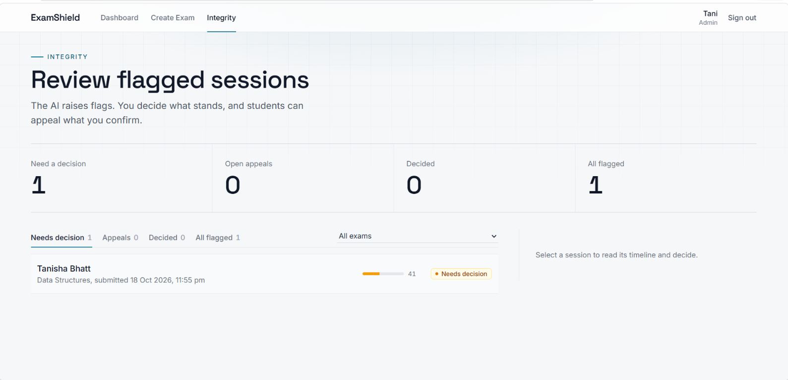
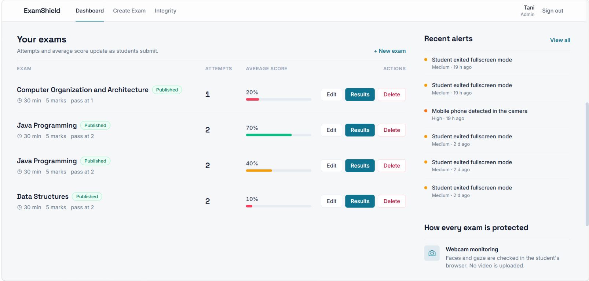
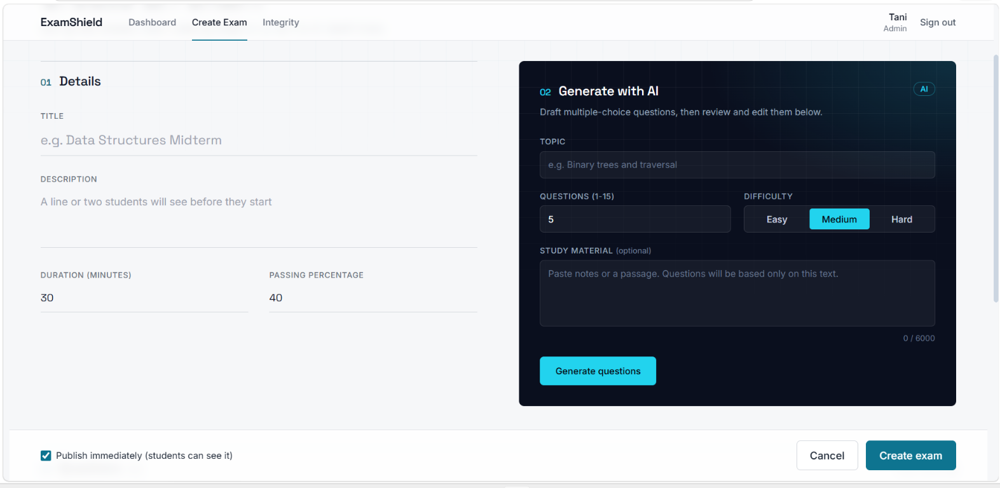
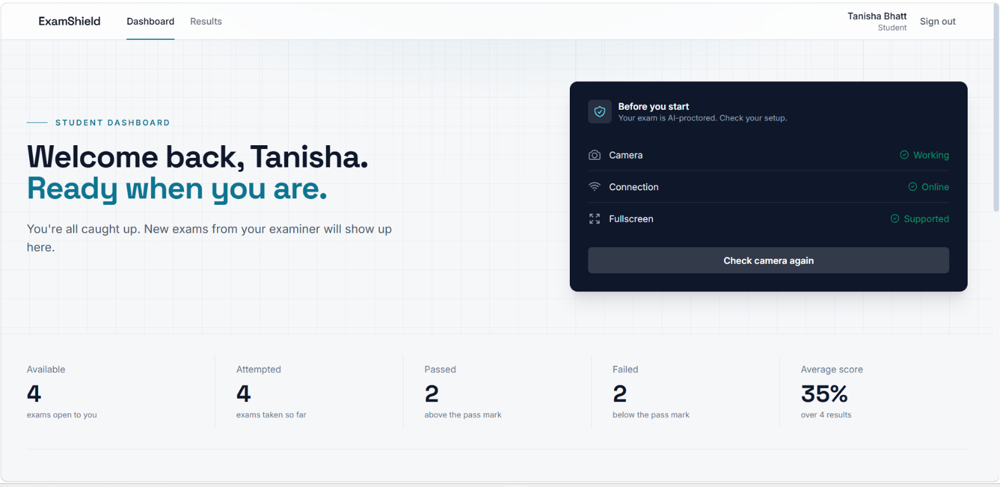
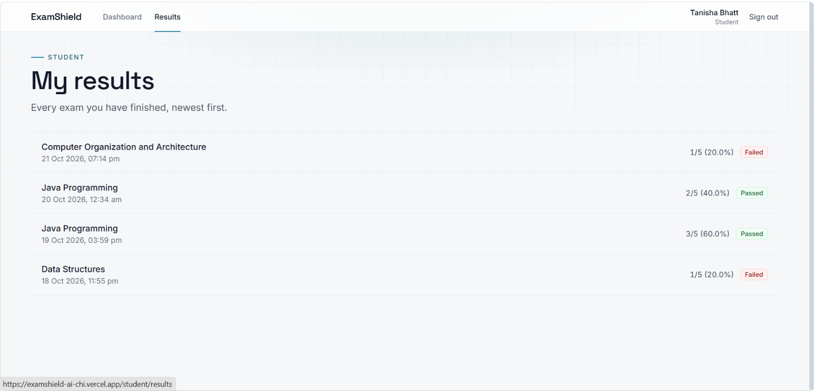
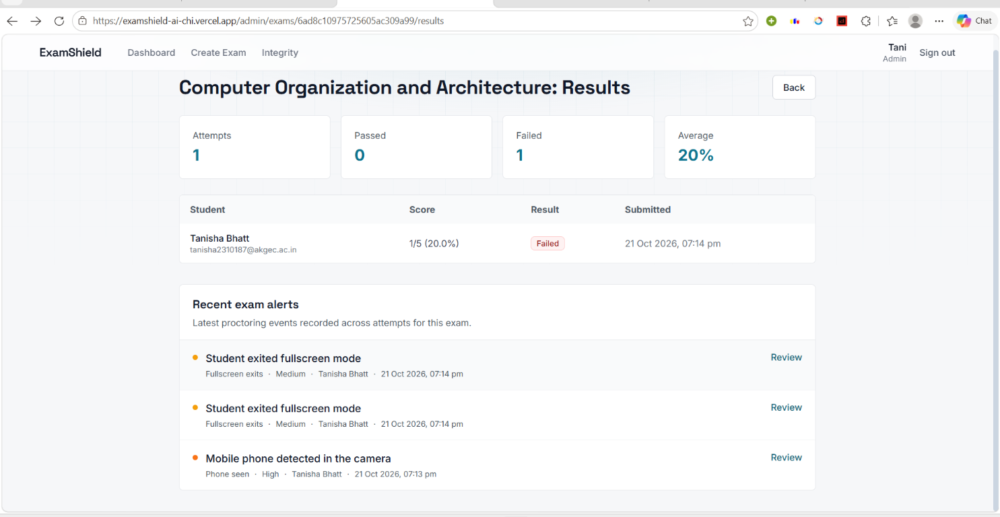

# ExamShield AI

Proctored online exams where the camera is analysed **inside the student's browser**. No video is uploaded. The examiner receives only short event records, decides what stands, and students can appeal.

**Live demo:** https://examshield-ai-chi.vercel.app
**API docs:** https://examshield-ai-u4nt.onrender.com/docs (free tier, the first request can take about a minute to wake up)



## What it does

- **Exam builder.** Create exams with multiple-choice, short-answer and essay questions. Draft multiple-choice questions from a topic or pasted notes with Google Gemini, then review and edit them before publishing.
- **Proctoring in the browser.** MediaPipe face and object models run on the student's device. Only small event records (type, severity, time) are sent to the server.
- **Human-in-the-loop integrity review.** Events add up to a suspicion score and a suggested outcome, but an examiner confirms or dismisses each flag. Students are told only about flags that were confirmed, and can appeal them.
- **AI grading with examiner override.** Written answers are scored by Gemini against a model answer and an optional marking guide. Low-confidence answers are flagged, and the examiner can change any mark.
- **Resilient exam session.** Answers autosave to the server and to the device. A refresh or dropped connection resumes the same session with the timer intact.
- **Analytics.** Pass rate, score distribution, time taken and per-question difficulty for each exam.

## Screenshots

| | |
|---|---|
|  **Admin dashboard.** Integrity snapshot, KPIs and per-exam results. |  **Integrity queue.** Flagged sessions across all exams, open appeals first. |
|  **Exams and recent alerts.** |  **Create exam**, with the Gemini question generator. |
|  **Student dashboard.** Readiness check before an exam. |  **Student results.** |
|  **Exam results.** Per-student scores and exam-specific proctoring alerts. | |

## How proctoring works

The browser samples the camera twice a second. A problem must last several samples in a row before it counts, so a cough or a glance down does not flag anyone. Each signal has a fixed weight, and the same table is used by the detection hook, the pre-exam notice and the landing page (`frontend/src/services/policy.ts`).

| Signal | Triggered when | Severity | Points |
|---|---|---|---|
| More than one person | A second face stays in view for about 1.5 s | Critical | 15 |
| Phone in view | Seen in two checks in a row (a hint, not proof) | High | 8 |
| No face in view | Nobody visible for about 3 s | High | 8 |
| Camera turned off | The video stream ends mid-exam | High | 8 |
| Left the exam tab | Tab or window switch. The exam is submitted at 3 | Medium | 3 |
| Left fullscreen | Fullscreen is exited | Medium | 3 |
| Looking away | Head or eyes turned from the screen for about 3 s | Medium | 3 |
| Eyes closed | Eyes closed for about 4 s | Low | 1 |

The score is the sum of the points, capped at 100. Below 20 is **approve**, 20 to 49 is **review**, and 50 and above is **reject**. This is a recommendation only.

### Integrity workflow

1. A finished session with a score of 20 or more appears in the examiner's queue as **Needs decision**.
2. The examiner reads the timeline and **confirms** (a note is required and the student can read it) or **dismisses** the flag. A flag can be decided only once.
3. A student sees nothing while a flag is pending or dismissed. Their result looks the same as an unflagged one, and the API never returns proctoring data to them.
4. For a confirmed flag the student sees the recorded events and the examiner's note, and can appeal within 7 days.
5. The examiner **upholds** or **overturns** the appeal with a note. Every step is written to an audit history.

## Architecture

```
React 18 + TypeScript + Vite + Tailwind + Framer Motion   (Vercel)
        |  axios, JWT bearer token
FastAPI (async) + Motor                                    (Render)
        |
MongoDB Atlas      Google Gemini API (question drafts, written-answer grading)
```

```
backend/
  app/core/       config, database + indexes, JWT/bcrypt, rate limiting, helpers
  app/routes/     auth, student, admin, proctoring, integrity
  app/services/   ai_service (question drafts), grading_service, integrity_logic (pure rules)
  scripts/        make_admin.py, seed_demo.py
  tests/          115 tests against an in-memory Mongo
frontend/src/
  pages/          Landing, Auth, Dashboard, Exam, Admin
  hooks/          useProctoring, useExamTimer, useDraftSync
  services/       API clients and policy.ts (the proctoring rules)
```

Design decisions worth knowing:

- **Grading is server-side.** Correct answers and marking guides never leave the server until the exam is submitted.
- **Prompt-injection defences in the grader.** Student answers are escaped before they go into the prompt, length-capped, and the model's reply is re-validated by the server. Marks are clamped to the question's maximum, unknown question ids are dropped, and half-mark steps are enforced.
- **One ongoing session per student and exam** is enforced by a partial unique index, and starting an exam twice resumes the same session.
- **Rate limiting.** An in-memory limiter covers login, register and submit, and counts authenticated traffic per user so a whole lab behind one NAT is not locked out. AI generation has a separate MongoDB-backed counter shared across instances.
- **Admins are never created through the API.** Everyone registers as a student, and admins are promoted from the server with a script.

## Run it locally

You need Python 3.10+, Node 18+ and a MongoDB Atlas connection string.

**Backend** (PowerShell, from `backend`):

```powershell
python -m venv .venv
.\.venv\Scripts\Activate.ps1
pip install -r requirements-dev.txt
```

Create `backend/.env`:

```
MONGODB_URI=mongodb+srv://<user>:<password>@<cluster>/examshield
JWT_SECRET_KEY=<at least 32 characters>
GEMINI_API_KEY=<optional: needed for AI question drafts and written-answer grading>
FRONTEND_URL=http://localhost:5173
DEBUG=true
```

Generate a secret with `python -c "import secrets; print(secrets.token_urlsafe(48))"`. Then:

```powershell
uvicorn app.main:app --reload --port 8000
```

**Frontend** (from `frontend`):

```powershell
"VITE_API_URL=/api" | Out-File -Encoding ascii .env.local
npm install
npm run dev
```

The dev server proxies `/api` to `http://localhost:8000`. For a deployed frontend, set `VITE_API_URL` to the backend URL ending in `/api`.

**Make yourself an admin.** Register in the app, then:

```powershell
python -m scripts.make_admin you@example.com
```

Sign out and back in, because the role is stored in the login token.

**Demo data** (optional):

```powershell
python -m scripts.seed_demo --yes
```

This creates `admin@demo.examshield.dev` and `student@demo.examshield.dev`, both with the password `Demo@1234`, plus exams, students and flagged sessions. Re-running it replaces the previous demo data.

### Environment variables

| Variable | Purpose |
|---|---|
| `MONGODB_URI` | Atlas connection string |
| `JWT_SECRET_KEY` | Required outside `DEBUG`, at least 32 characters |
| `GEMINI_API_KEY`, `GEMINI_MODEL` | Question drafts and grading. The model is optional and falls back to a built-in list |
| `FRONTEND_URL`, `EXTRA_CORS_ORIGINS` | Allowed browser origins |
| `EXTRA_ALLOWED_HOSTS` | Extra hostnames for the trusted-host check (for example your Render host) |
| `RATE_LIMIT_ENABLED` | `true` by default |

## Tests

```powershell
cd backend;  python -m pytest -q      # 115 backend tests
cd ../frontend; npm test              # proctoring policy tests
npm run build                         # type-check and production build
```

The backend tests cover access control, the full exam flow, student privacy (no proctoring data in student responses), the integrity and appeal rules, rate limiting, concurrency on session start, AI-grade parsing and the grader's prompt-injection handling.

## Limitations

- Proctoring signals are **advisory**. Detection can be wrong, and the product says so to students before they start.
- Detection runs in the student's browser, so a determined student with developer tools could suppress or forge events. That is why every flag goes to a human, and why the auto-submit at 3 tab switches is performed by the browser, with the server only recording that the limit was reached.
- The in-memory rate limiter is per process. Running several backend instances would need a shared store such as Redis.
- AI question drafting produces multiple-choice questions only. Written answers are scored by AI and should be spot-checked, which is what the examiner-override view is for.
- On free hosting the API sleeps when idle, so the first request after a pause is slow.

## Author

Tanisha Bhatt. Final-year B.Tech project. Source: https://github.com/Error404-ai/Examshield-ai